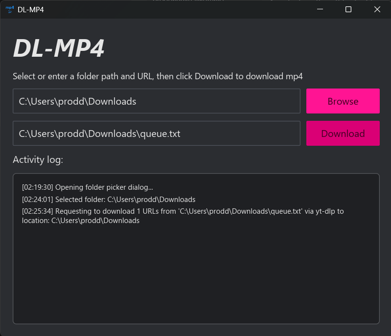
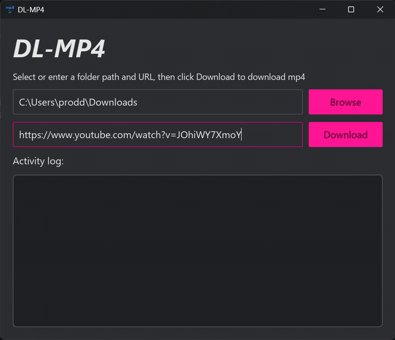
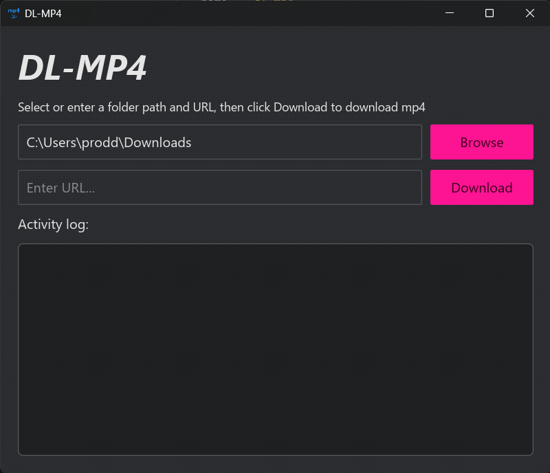
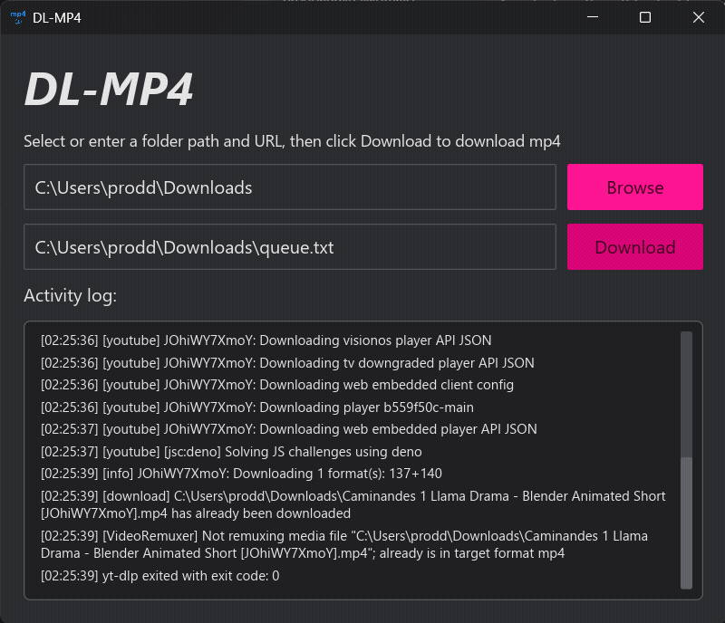

# DL-MP4

A small Windows desktop app that downloads videos as MP4. Paste a page URL, pick a folder, and DL-MP4 runs [yt-dlp](https://github.com/yt-dlp/yt-dlp) with [aria2c](https://aria2.github.io/) in the background. Progress and errors show up in an activity log inside the window.

<p align="center">
  
</p>

## Features

- Dark window with a single folder field, a URL field, and a live activity log
- Folder picker, plus a typed path if you already know where the file should go
- Remembers the last usable folder in `%APPDATA%\dl-mp4\folder.txt` and falls back to Downloads when that path is missing
- Accepts one URL, or a `.txt` file with one URL per line
- Strips matching wrapping quotes from pasted paths and URLs
- Streams yt-dlp output into the log without opening a console window
- Embeds the app icon on Windows

## Screenshots

The window opens on the last saved folder. On a fresh run that is your Downloads folder.

<p align="center">
  
</p>

A finished download of [Caminandes 1: Llama Drama](https://www.youtube.com/watch?v=JOhiWY7XmoY), a 90-second Creative Commons short:

<p align="center">
  
</p>

A batch run from a text file in that same folder:

<p align="center">
  
</p>

## Usage

DL-MP4 does not ship yt-dlp or aria2c. Both need to be on `PATH` before you press **Download**.

1. Open the app.
2. Leave the folder as Downloads, type a path, or click **Browse**.
3. Paste a page URL, or the path of a `.txt` file that lists URLs.
4. Click **Download** and watch the activity log.

### Single URL

<p align="center">
  
</p>

Values used in the clip:

| Field | Value |
| --- | --- |
| Folder | `C:\Users\prodd\Downloads` |
| URL | `https://www.youtube.com/watch?v=JOhiWY7XmoY` |

The clip is 1 minute 30 seconds. yt-dlp writes the MP4 into Downloads, and the log ends with `yt-dlp exited with exit code: 0`.

### Browse for a folder

<p align="center">
  
</p>

The dialog title is **Select a folder**. A usable choice is saved and restored the next time the app starts. If the saved folder is gone, DL-MP4 switches back to Downloads and says so in the log.

### Batch from a text file

<p align="center">
  
</p>

Put the path of a `.txt` file in the URL field. Blank lines are skipped. Each remaining line is one URL, and matching quotes around a line are removed.

`C:\Users\prodd\Downloads\queue.txt`:

```text
https://www.youtube.com/watch?v=JOhiWY7XmoY
```

The log reports that the URL was read from that file and sent to yt-dlp. With the file already in Downloads, yt-dlp reports that it has already been downloaded and exits 0.

### What the download command does

DL-MP4 starts `yt-dlp` with no console window and feeds the URL list on stdin:

```text
yt-dlp --newline --downloader aria2c --extractor-args generic:impersonate -P "C:\Users\prodd\Downloads" -t mp4 -a -
```

`-t mp4` asks yt-dlp for an MP4. `-P` is the folder from the window. aria2c is the downloader. If `yt-dlp` is not on `PATH`, the log shows `Failed to start yt-dlp`.

## Requirements

- Windows
- [Rust](https://www.rust-lang.org/tools/install) (edition 2024) to build from source
- [yt-dlp](https://github.com/yt-dlp/yt-dlp) on `PATH`
- [aria2c](https://aria2.github.io/) on `PATH`
- ffmpeg on `PATH` when yt-dlp needs to merge or remux into MP4

## Build and run

```powershell
cargo run --release
```

The release binary is `target\release\dl-mp4.exe`. The window title is **DL-MP4**, and the default size is 640×520.

## Saved folder

The last good folder is stored as plain text:

```text
%APPDATA%\dl-mp4\folder.txt
```

Example contents:

```text
C:\Users\prodd\Downloads
```

The file is rewritten when a download starts and when you pick a folder. A path that is not an existing directory is rejected, and the app returns to Downloads.

## Project layout

```text
dl-mp4/
├── assets/
│   └── app_icon.ico
├── build.rs
├── Cargo.toml
├── docs/
│   └── media/
└── src/
    ├── lib.rs      # folder config, URL lists, yt-dlp process
    └── main.rs     # iced window
```
